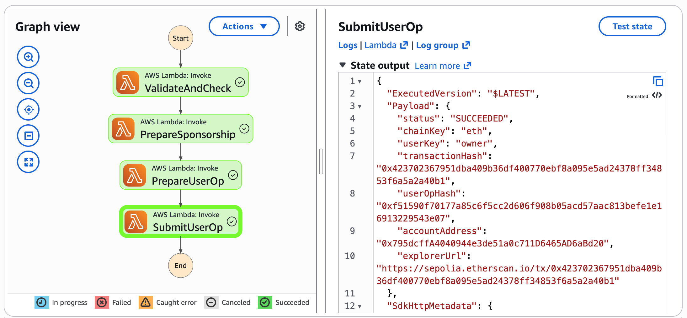
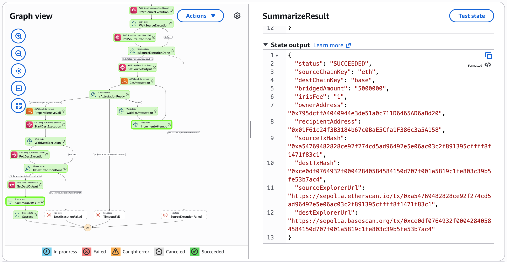
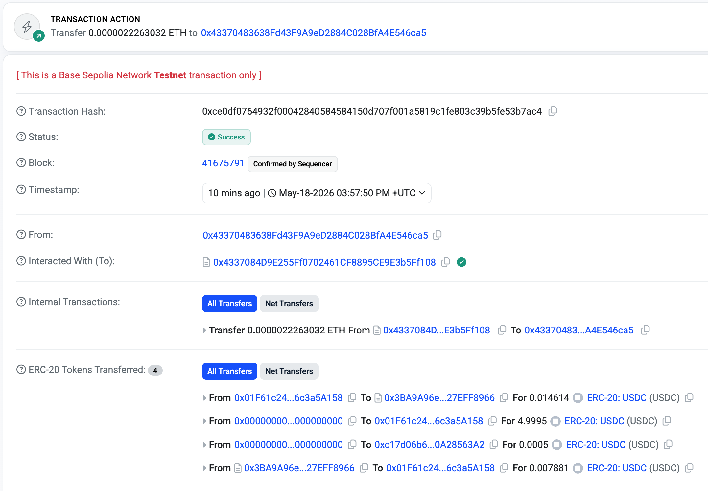

# Gasless USDC transfers with Circle Paymaster on AWS

Move USDC on EVM chains without holding any ETH. This repository deploys a
serverless implementation of [Circle Paymaster](https://developers.circle.com/stablecoins/paymaster-overview)
on AWS, so gas fees are paid in USDC instead of the chain's native token, and
exposes the result to an AI agent through the
[Model Context Protocol (MCP)](https://modelcontextprotocol.io/).

Companion code for the AWS Web3 Blog post
**"Pay Ethereum gas fees in USDC with Circle Paymaster and AWS Step Functions"**.


Three CloudFormation stacks are deployed, each building on the one before it:

| Stack | Directory | What it does |
|---|---|---|
| `gasless-paymaster` | [`gasless-workflow/`](gasless-workflow) | Runs any contract call as an ERC-4337 UserOperation, with the gas fee paid in USDC through Circle Paymaster. This is the reusable core. |
| `cctp-bridge` | [`cctp-bridge/`](cctp-bridge) | Moves USDC between chains with [Circle CCTP](https://developers.circle.com/stablecoins/cctp-getting-started), invoking the gasless workflow twice: once to burn on the source chain, once to mint on the destination chain. |
| `paymaster-agent-tools` | [`agent-tools/`](agent-tools) | Two Step Functions state machines, described by Amazon EventBridge schemas, that turn the two workflows into tools an AI agent can call in natural language. |

The bridge does not reimplement any Paymaster logic, and the agent tools do not
reimplement any bridging logic. Each layer delegates to the one below it, which
is why the stacks must be deployed in the order above. `deploy.sh` handles that
ordering, and the ARN plumbing between the stacks, for you.

> **Testnet only.** Every address in this repository is an Ethereum Sepolia,
> Base Sepolia, or Arbitrum Sepolia testnet address. The wallet keys generated by
> `deploy.sh` are throwaway keys for testing. Never reuse them on a mainnet, and
> never fund them with real assets.

## Contents

- [Prerequisites](#prerequisites)
- [Quick start](#quick-start)
- [Manual deployment (optional)](#manual-deployment-optional)
- [Using the workflows](#using-the-workflows)
- [Configuration reference](#configuration-reference)
- [How it works](#how-it-works)
- [Troubleshooting](#troubleshooting)
- [Clean up](#clean-up)
- [Security](#security)

## Prerequisites

| Requirement | Notes |
|---|---|
| AWS account | Permissions to create Lambda functions, Step Functions state machines, Secrets Manager secrets, EventBridge schema registries, and IAM roles. |
| Node.js 20 or later | Used by the helper scripts and the esbuild bundling step. Pre-installed in [AWS CloudShell](https://aws.amazon.com/cloudshell/). The Lambda functions themselves run on the `nodejs24.x` runtime. |
| [AWS CLI](https://aws.amazon.com/cli/) and [AWS SAM CLI](https://aws.amazon.com/serverless/sam/) | Both pre-installed in AWS CloudShell. |
| Testnet USDC | Free from the [Circle faucet](https://faucet.circle.com). Request 20 USDC on Ethereum Sepolia and 20 USDC on Base Sepolia, one faucet request each. Every Ethereum Sepolia transaction costs about 2 USDC in fees on top of the amount you send. |
| An MCP-capable desktop agent | Claude Desktop or Amazon Quick Desktop, plus `uv` and Python 3.12 to run the MCP server: `brew install uv && uv python install 3.12`. Only needed to talk to the agent tools; the deployment itself does not need it. |

No RPC provider account is required. The Lambda functions use public testnet RPC
endpoints, which you can change in `lib/config.mjs` if you prefer your own.

**Cost.** All the AWS services used here are pay-per-use and the workflows are
short-lived, so running the walkthrough a handful of times costs a few cents.
The main standing charge is Secrets Manager, at roughly USD 0.40 per secret per
month for the two secrets. Delete the resources when you are done, as described
in [Clean up](#clean-up).

The fastest way to run this is [AWS CloudShell](https://aws.amazon.com/cloudshell/),
which comes with every prerequisite except the desktop agent already installed.

**Choosing the AWS Region.** Everything deploys into the Region of your AWS CLI
configuration, and nothing in the templates is tied to a particular Region. Open
CloudShell in the Region you want, then check it:

```bash
aws configure list | grep region
```

If it is empty or wrong, set it with `aws configure set region <region>`. You can
also pick the Region for a single run with the `AWS_REGION` or `AWS_DEFAULT_REGION`
environment variable, which takes precedence over the configuration file:

```bash
AWS_REGION=ap-southeast-2 ./deploy.sh
```

`deploy.sh` prints the Region it uses on the `Checking prerequisites` step, and
uses that same Region for the stacks, the IAM policy and the MCP configuration.

The IAM user `paymaster-mcp-user` and its policy are global, so they exist once
per account. Deploy into one Region at a time: a second deployment in another
Region replaces the first one's policy and access key, and `./deploy.sh destroy`
in either Region deletes them.

## Quick start

**`deploy.sh` is all you need.** One command deploys everything, and you do not
have to follow any of the steps in [Manual deployment](#manual-deployment-optional),
which exists only to explain what the script automates.

```bash
git clone https://github.com/aws-samples/sample-blogpost-web3-42.git
cd sample-blogpost-web3-42
./deploy.sh
```

The whole run takes about 8 minutes, most of it spent building and deploying the
stacks. In order, `deploy.sh`:

1. Generates two throwaway wallet keys and writes them to `.env`.
2. **Pauses so you can fund the wallets** at the Circle faucet (see below), unless
   the owner wallet already holds enough USDC.
3. Stores the keys in AWS Secrets Manager, then builds and deploys the three
   stacks in the right order and registers the tool schemas.
4. Creates a least-privilege IAM user for the MCP server.
5. Generates the MCP client configuration.

Two steps cannot be automated, so the script stops for them:

- **Funding the wallets.** The script prints the two addresses. Open the
  [Circle faucet](https://faucet.circle.com), request 20 USDC on Ethereum Sepolia
  for the owner address and 20 USDC on Base Sepolia for the recipient address,
  then press Enter.
- **Configuring your MCP client.** This happens on the machine that runs your
  desktop agent, so it comes after the script finishes. See the next section.

### Configure your MCP client

When `deploy.sh` finishes, `agent-tools/config/` holds the two files your agent
needs:

| File | Content |
|---|---|
| `paymaster-mcp.credentials` | The AWS profile `paymaster-mcp`, with the access key of the least-privilege IAM user. Keep it private. |
| `mcp-claude-desktop.json` | The MCP server configuration, with your Region, the two tool names, and `AWS_PROFILE` set to `paymaster-mcp`. |

**1. Get the files onto the machine that runs your agent.** If you deployed from
your laptop, they are already there. If you deployed from AWS CloudShell, print
both and copy them to your laptop:

```bash
cat agent-tools/config/paymaster-mcp.credentials
cat agent-tools/config/mcp-claude-desktop.json
```

**2. Install `uv` and Python 3.12** on that machine. The MCP server runs through
`uvx`. The following command is only an example for macOS with Homebrew; on other
systems, follow the [uv installation guide](https://docs.astral.sh/uv/getting-started/installation/):

```bash
brew install uv && uv python install 3.12
```

**3. Add the AWS profile.** Append the contents of `paymaster-mcp.credentials` to
`~/.aws/credentials`, and create the file if it does not exist. If the file
already contains a `[paymaster-mcp]` section from an earlier deployment, replace
that section instead of appending a second one.

**4. Add the MCP server to your agent.**

- **Claude Desktop.** Merge the `mcpServers` block of `mcp-claude-desktop.json`
  into your configuration file, then fully quit the app with **Cmd+Q** and
  reopen it.
  - macOS: `~/Library/Application Support/Claude/claude_desktop_config.json`
  - Windows: `%APPDATA%\Claude\claude_desktop_config.json`
- **Amazon Quick Desktop.** Go to **Settings**, then **Capabilities**, then
  **MCP**, then **+ Add MCP**, then **Import**, and select
  `mcp-claude-desktop.json`. No restart is needed.

**5. Try it.** The server `awslabs.stepfunctions-tool-mcp-server` should now be
connected with two tools. Ask your agent, with your own recipient address:

> Send 1 USDC to `0xYOUR_RECIPIENT_ADDRESS` on Ethereum Sepolia.

The agent asks you to confirm, and a transfer takes about 20 seconds. See
[From an AI agent](#from-an-ai-agent) for more prompts, and
[Agent and MCP](#agent-and-mcp) if the tools do not appear.

### Running it again

`deploy.sh` is idempotent, so you can run it again at any time: after a failure,
after changing the code, or to refresh the MCP configuration. It reuses your
existing keys, updates the stacks in place, and skips anything that is already
up to date. It never rotates the MCP access key while the key stored in
`agent-tools/config/paymaster-mcp.credentials` is still valid.

Individual phases can also be run on their own:

```bash
./deploy.sh keys      # Generate wallet keys and write .env
./deploy.sh fund      # Check balances and print faucet instructions
./deploy.sh stacks    # Store secrets, then build and deploy all 3 stacks
./deploy.sh harden    # Create the least-privilege IAM user for the MCP server
./deploy.sh mcp       # Build the MCP client configuration
./deploy.sh status    # Show what is currently deployed
./deploy.sh destroy   # Delete every AWS resource this script created
```

## Manual deployment (optional)

**You do not need this section.** `./deploy.sh` in the [Quick start](#quick-start)
already does everything below. Read on only if you want to understand what the
script automates, or if you prefer to run each step yourself. All commands are
run from the repository root.

### Step 1: Generate and fund wallets

Two keypairs are needed: an *owner*, which sends USDC and pays the gas fees in
USDC, and a *recipient*, which receives the funds and pays the gas fee on the
destination chain of a bridge.

```bash
./deploy.sh keys
```

This writes `.env` with file permissions `600`, copies it into
`gasless-workflow/` and `cctp-bridge/`, and prints both addresses. The contract
addresses come from `cctp-bridge/.env.example`, which already lists every
testnet address the workflows use.

Fund the two addresses at the [Circle faucet](https://faucet.circle.com):

| Address | Chain | Amount | Why |
|---|---|---|---|
| `OWNER_ADDRESS` | Ethereum Sepolia | 20 USDC (one faucet request) | The amount you send, plus about 2 USDC in Paymaster fees for every transaction |
| `RECIPIENT_ADDRESS` | Base Sepolia | 20 USDC (one faucet request) | The Paymaster fee on the destination chain of a bridge, which is a fraction of a USDC |

The faucet allows one request per address and network every 2 hours. Each
Ethereum Sepolia transaction costs about 2 USDC in fees at typical testnet gas
prices, so 20 USDC covers a transfer, a bridge, and a few agent calls. The
examples in this guide send 1 or 2 USDC for that reason.

Confirm the balances arrived:

```bash
./deploy.sh status
```

### Step 2: Deploy the gasless workflow

Upload the private keys to AWS Secrets Manager as `paymaster-key-owner` and
`paymaster-key-recipient`, then deploy the stack:

```bash
cd gasless-workflow
npm install
node scripts/aws-setup.mjs

sam build
sam deploy --stack-name gasless-paymaster \
  --capabilities CAPABILITY_IAM --resolve-s3 --no-confirm-changeset
cd ..
```

Capture the state machine ARN, which the next two stacks need:

```bash
export GASLESS_SM_ARN=$(aws cloudformation describe-stacks \
  --stack-name gasless-paymaster \
  --query "Stacks[0].Outputs[?OutputKey=='StateMachineArn'].OutputValue" \
  --output text)
```

### Step 3: Deploy the CCTP bridge

The bridge runs each onchain leg as a nested execution of the gasless workflow, so
it takes that state machine's ARN as a parameter.

```bash
cd cctp-bridge
npm install

sam build
sam deploy --stack-name cctp-bridge \
  --capabilities CAPABILITY_IAM --resolve-s3 --no-confirm-changeset \
  --parameter-overrides GaslessWorkflowStateMachineArn=$GASLESS_SM_ARN
cd ..

export BRIDGE_SM_ARN=$(aws cloudformation describe-stacks \
  --stack-name cctp-bridge \
  --query "Stacks[0].Outputs[?OutputKey=='CctpBridgeStateMachineArn'].OutputValue" \
  --output text)
```

### Step 4: Register the tool schemas

The MCP server reads these JSON Schema documents to build the tool definitions
it advertises to the agent, so they must exist before the agent tools stack is
deployed.

```bash
aws schemas create-registry \
  --registry-name paymaster-schemas \
  --description "Input schemas for Circle Paymaster MCP tools"

aws schemas create-schema \
  --registry-name paymaster-schemas --schema-name GaslessTransferToolInput \
  --type JSONSchemaDraft4 \
  --description "Input schema for the GaslessTransferTool MCP tool" \
  --content file://agent-tools/schemas/GaslessTransferToolInput.json

aws schemas create-schema \
  --registry-name paymaster-schemas --schema-name CctpBridgeToolInput \
  --type JSONSchemaDraft4 \
  --description "Input schema for the CctpBridgeTool MCP tool" \
  --content file://agent-tools/schemas/CctpBridgeToolInput.json
```

### Step 5: Deploy the agent tools

This stack has no Paymaster or bridging logic of its own, so it takes the two
ARNs captured above as parameters.

```bash
cd agent-tools
npm install

sam build
sam deploy --stack-name paymaster-agent-tools \
  --capabilities CAPABILITY_IAM --resolve-s3 --no-confirm-changeset \
  --parameter-overrides \
    GaslessWorkflowStateMachineArn=$GASLESS_SM_ARN \
    CctpBridgeStateMachineArn=$BRIDGE_SM_ARN
cd ..
```

### Step 6: Create the MCP server identity and configuration

The MCP server should not run with your own AWS credentials, which usually
have broad permissions. `deploy.sh harden` creates a dedicated IAM user that
can only start and describe executions on the two tool state machines and read
the two schemas. It cannot read the wallet keys in Secrets Manager and cannot
change any resource.

```bash
./deploy.sh harden
./deploy.sh mcp
```

Both commands write into `agent-tools/config/`:

| File | Content |
|---|---|
| `paymaster-mcp.credentials` | The AWS profile `paymaster-mcp` with the access key of the new user. File permissions are `600`, and the secret is never printed. |
| `mcp-claude-desktop.json` | The MCP server configuration, with your Region, the two state machine names, and `AWS_PROFILE` set to `paymaster-mcp`. |

The MCP server makes only these API calls:

| Phase | API calls | Why |
|---|---|---|
| Startup | `states:ListStateMachines`, `states:DescribeStateMachine`, `states:ListTagsForResource` | Discovers the state machines named in `STATE_MACHINE_LIST`, reads their descriptions, and finds the `inputSchemaArn` tag. `ListStateMachines` cannot be restricted to specific resources, so the user can list all state machines in the account. |
| Startup | `schemas:DescribeSchema` | Reads the JSON Schema that defines each tool's input |
| Execution | `states:StartExecution`, `states:DescribeExecution` | Starts a workflow and polls for the result |

A long-lived access key is used because desktop MCP clients read static AWS
profiles. Where your client supports it, prefer
[AWS IAM Identity Center](https://aws.amazon.com/iam/identity-center/) with
short-lived credentials. `./deploy.sh destroy` deletes the user, its key, and the
policy.

Then install both files on the machine that runs your agent, as described in
[Configure your MCP client](#configure-your-mcp-client).

To generate the configuration by hand instead of through `deploy.sh mcp`, export
`TRANSFER_SM_NAME` and `BRIDGE_SM_NAME` from the stack outputs of
`paymaster-agent-tools`, and optionally `MCP_AWS_PROFILE=paymaster-mcp`, then run
`bash agent-tools/local-test/update-mcp-config.sh`.


## Using the workflows

### From the Step Functions console

**A gasless transfer.** Generate a test input, then start an execution:

```bash
cd gasless-workflow
node local-test/generate-event.mjs   # writes local-test/test-event.json
cd ..
```

1. Open the [Step Functions console](https://console.aws.amazon.com/states/home)
   and choose **State machines**.
2. Choose `GaslessWorkflowStateMachine`.
3. Choose **Start execution**.
4. Paste the contents of `gasless-workflow/local-test/test-event.json` into the
   **Input** box.
5. Choose **Start execution**.

All four states turn green in about 20 seconds. The **Output** panel shows the
transaction hash and a block explorer link.



**A crosschain bridge.** Choose `CctpBridgeStateMachine` and use this input:

```json
{
  "sourceChainKey": "eth",
  "destChainKey": "base",
  "bridgeAmount": "2000000"
}
```

`bridgeAmount` is in base units, so `2000000` is 2 USDC. During the attestation
phase the `GetAttestation`, `WaitForAttestation`, and `IncrementAttempt` loop
cycles every 5 seconds, which is expected. A Fast Transfer attestation usually
is ready within seconds, so the execution succeeds after about 30 to 60 seconds
and the output contains both transaction hashes. The state machine allows up to
5 minutes for the attestation.



### From an AI agent

In Claude Desktop, choose **Customize**, then **Connectors**, and confirm
`awslabs.stepfunctions-tool-mcp-server` is connected with two tools. In Amazon
Quick Desktop, the server is listed under **Settings**, then **Capabilities**,
then **MCP**.

Then ask for a transfer in plain language, replacing the address with your own
`RECIPIENT_ADDRESS`:

> Send 2 USDC to `0xYOUR_RECIPIENT_ADDRESS` on Ethereum Sepolia.

The agent picks `GaslessTransferTool`, fills in the parameters from your
sentence, and asks you to confirm before it runs. When the workflow finishes,
the agent reports the result with an explorer link. A transfer takes about
20 seconds.

A bridge works the same way:

> Bridge 2 USDC from Ethereum Sepolia to Base Sepolia for recipient `0xYOUR_RECIPIENT_ADDRESS`.

The agent waits through the attestation period and returns both links, usually
within a minute.

Because `recipientAddress` also pays the Paymaster fee on the destination chain,
make sure it still holds USDC on Base Sepolia before running a bridge. Top it up
at the [Circle faucet](https://faucet.circle.com) if needed.

### What happens onchain

A single gasless transfer emits the following events, in this order. They show
how the fee is collected in USDC rather than ETH:

| # | Event | Emitted by | Meaning |
|---|---|---|---|
| 1 | `Approval` | USDC | The Paymaster called `permit()` and now has a USDC spending allowance |
| 2 | `Transfer` | USDC | The Paymaster pre-charged the maximum estimated gas cost in USDC |
| 3 | `BeforeExecution` | EntryPoint | Validation passed, your calls are about to run |
| 4 | `Transfer` | USDC | Your actual transfer |
| 5 | `Transfer` | USDC | The unused part of the pre-charge is refunded to you |
| 6 | `UserOperationSponsored` | Paymaster | The final fee breakdown and exchange rate used |
| 7 | `UserOperationEvent` | EntryPoint | `success: true`, with the final gas cost |
| 8 | ETH `Transfer` | EntryPoint | The EntryPoint pays the ETH gas cost back to the bundler. It appears as a transfer from `0xffff...fffe` on some explorers |

The ETH transfer is the Paymaster paying the gas on your behalf. Your USDC
balance is the only balance that changes. On the destination side of a bridge,
the explorer additionally shows several USDC transfers covering the CCTP mint and
the attestation service fee.




## Configuration reference

### Repository layout

```
gasless-workflow/         The reusable core: one gasless transaction
  functions/              4 Lambda functions: validate, sponsor, build, submit
  lib/                    Shared helpers: chain config, EIP-2612 permit, secrets
  statemachine/           State machine definition
  scripts/aws-setup.mjs   Uploads private keys to Secrets Manager
  template.yaml           SAM template

cctp-bridge/              Crosschain USDC, built on gasless-workflow
  functions/              4 Lambda functions: validate, prepare, attest, receive
  lib/cctp.mjs            CCTP message encoding and domain mapping
  local-test/step*.mjs    Optional: run each stage on your machine with
                          `sam local invoke` (needs Docker; see the header of each script)

agent-tools/              MCP-facing adapter layer
  functions/              2 adapter functions, with no permissions beyond their own logs
  schemas/                JSON Schemas that define the agent tool contracts
  config/                 MCP client configuration (deploy.sh adds the generated credentials file)
  paymaster-mcp-policy_template.json   Least-privilege IAM policy
```

### Workflow input

The gasless workflow takes a list of contract calls, which is what makes it
generic. Sending USDC is just one possible `calls` entry:

```json
{
  "chainKey": "eth",
  "userKey": "owner",
  "calls": [
    {
      "to": "0x1c7D4B196Cb0C7B01d743Fbc6116a902379C7238",
      "abi": "[{\"name\":\"transfer\", ...}]",
      "functionName": "transfer",
      "args": ["0xRECIPIENT", "1000000"]
    }
  ]
}
```

| Field | Meaning |
|---|---|
| `chainKey` | `eth` for Ethereum Sepolia, `base` for Base Sepolia, `arb` for Arbitrum Sepolia |
| `userKey` | Which Secrets Manager secret to sign with: `owner` reads `paymaster-key-owner` |
| `calls` | One or more contract calls, executed in a single UserOperation |

Amounts in `args` are in base units, so `1000000` is 1 USDC.

### Agent tool input

The tool schemas accept human-readable amounts, because that is what people say
to an agent. The adapter functions convert them to base units and build the
`calls` array:

| Field | `GaslessTransferToolInput` | `CctpBridgeToolInput` |
|---|---|---|
| Chain | `chainKey`, one of `eth`, `base`, `arb` | `sourceChainKey` and `destChainKey`, same values |
| `amountUsdc` | number, 0.000001 to 100, for example `1.0` | same |
| `recipientAddress` | required, must match `^0x[0-9a-fA-F]{40}$` | optional, defaults to the recipient smart account |

### Environment variables

`.env` is generated by `./deploy.sh keys` and read by `scripts/aws-setup.mjs`.
It is never deployed, and it is listed in `.gitignore`.

| Variable | Used for |
|---|---|
| `OWNER_PRIVATE_KEY`, `OWNER_ADDRESS` | The sending account. The key becomes `paymaster-key-owner`. |
| `RECIPIENT_PRIVATE_KEY`, `RECIPIENT_ADDRESS` | The receiving account. The key becomes `paymaster-key-recipient`. |
| `*_USDC_ADDRESS`, `*_PAYMASTER_ADDRESS` | Contract addresses per chain, pre-filled with testnet values. |
| `*_TOKEN_MESSENGER_ADDRESS`, `*_MESSAGE_TRANSMITTER_ADDRESS` | CCTP contracts per chain, pre-filled. |

Two Lambda environment variables act as circuit breakers on the agent path, both
set in `agent-tools/template.yaml` and defaulting to `100`:

| Variable | Effect |
|---|---|
| `MAX_TRANSFER_USDC` | Rejects any agent-initiated transfer above this amount |
| `MAX_BRIDGE_USDC` | Rejects any agent-initiated bridge above this amount |

### RPC endpoints

The Lambda functions use public testnet RPC endpoints, defined in the `RPC_URLS`
map in `gasless-workflow/lib/config.mjs` and `cctp-bridge/lib/config.mjs`. If you
hit rate limits, replace the URLs in those maps with your own provider endpoints.

## How it works

A gasless transfer combines three Ethereum standards:

| Standard | Role |
|---|---|
| [EIP-7702](https://eips.ethereum.org/EIPS/eip-7702) | Lets a regular key pair delegate execution to a smart account implementation, so account abstraction works without deploying a contract wallet first |
| [EIP-2612](https://eips.ethereum.org/EIPS/eip-2612) | Lets the user authorize the Paymaster to spend USDC for fees with an offchain signature, so the approval itself costs no gas |
| [EIP-4337](https://eips.ethereum.org/EIPS/eip-4337) | Defines UserOperations, which a bundler submits and a Paymaster contract can pay for on the user's behalf |

The workflow runs as four Lambda functions behind a Step Functions state machine:

1. **Validate and check** confirms the request is well formed and that the sender
   holds enough USDC.
2. **Prepare sponsorship** signs the EIP-2612 permit and builds the
   `paymasterData` that authorizes the fee in USDC.
3. **Prepare user op** assembles the UserOperation, combining the business calls
   with the sponsorship data and signing it.
4. **Submit user op** sends the UserOperation to the bundler and waits for the
   receipt.

The fee authorization is independent of what the transaction actually does, which
is why the same workflow can sponsor any contract call rather than only transfers.

The bridge wraps this workflow rather than duplicating it. It burns USDC on the
source chain through a gasless transaction, polls the Circle attestation service
until the attestation is ready, then mints on the destination chain through a
second gasless transaction. The waiting happens in the state machine itself, so no
Lambda function sits idle and billable during the 1 to 2 minute attestation.

For a deeper introduction to CCTP, see
[Implement a USDC bridge on AWS](https://aws.amazon.com/blogs/web3/implement-a-usdc-bridge-on-aws/).


## Troubleshooting

### Deployment

**`ROLLBACK_COMPLETE` when deploying.** A stack in this state cannot be updated,
only replaced. `deploy.sh` detects and deletes it automatically. To do it
manually:

```bash
aws cloudformation delete-stack --stack-name gasless-paymaster
aws cloudformation wait stack-delete-complete --stack-name gasless-paymaster
```

**Agent tools deployment fails on a parameter.** `paymaster-agent-tools` requires
both `GaslessWorkflowStateMachineArn` and `CctpBridgeStateMachineArn`. Deploy the other two
stacks first, or just run `./deploy.sh stacks`, which handles the ordering.

### Execution

**Insufficient USDC balance.** Each Ethereum Sepolia transaction costs about
2 USDC in fees, so an owner holding 20 USDC can run roughly eight small
transactions. The recipient needs USDC on Base Sepolia to pay the
destination-chain Paymaster fee. Check with `./deploy.sh status`, and request more
at the faucet, which allows one request per address and network every 2 hours.

**`AA33 reverted` or a similar validation error.** The Paymaster could not
validate the sponsorship. The two usual causes are a USDC balance that is too low
to cover the pre-charge, and a gas limit for the Paymaster that is too low. An
empty revert reason (`AA33 reverted 0x`) means the Paymaster ran out of gas. The
limits are set in `gasless-workflow/functions/submit-user-op/index.mjs`:
`paymasterVerificationGasLimit` (500,000) and `paymasterPostOpGasLimit` (35,000).
Validate them if you replace the Paymaster or the chain.

**Submit step times out.** The submit function has a 120-second timeout. The
state machine does not retry it automatically. If the public bundler is rate
limiting you, wait a few seconds and start a new execution.

**Attestation loop reaches its attempt limit.** The execution fails with
`AttestationTimeout` after 60 attempts, about 5 minutes. **Do not start a new
execution with the same input.** The USDC was already burned on the source chain
by this execution, and a new execution would burn a second amount. Instead, open
the failed execution, copy `sourceTxHash` from the state input, and look it up
with the Circle attestation API:

```bash
curl "https://iris-api-sandbox.circle.com/v2/messages/0?transactionHash=<sourceTxHash>"
```

Use `0` for Ethereum Sepolia, `6` for Base Sepolia, and `3` for Arbitrum Sepolia.
When the `status` is `complete`, the message can be minted on the destination
chain through its `MessageTransmitter` contract.

### Agent and MCP

**The tools do not appear.** Claude Desktop must be fully quit with **Cmd+Q**,
not just closed, and reopened after the configuration file changes. Amazon Quick
Desktop loads servers dynamically and needs no restart.

**A bridge call times out in the agent.** Confirm `"timeout": 300` is present in
the MCP configuration. The default 60-second MCP timeout is shorter than the CCTP
attestation wait.

**"State machine not found".** The names in `STATE_MACHINE_LIST` must match the
deployed names exactly, including the random suffix CloudFormation appends.
Re-run `./deploy.sh mcp` after any redeployment.

**A tool reports that the sub-execution failed.** Open the Step Functions console
and inspect the failed child execution, which contains the underlying error. The
usual causes are a low USDC balance, bundler rate limiting, or an expired
sponsorship window.


## Clean up

Delete everything this repository created in your AWS account:

```bash
./deploy.sh destroy
```

The command asks you to type `delete`, then removes, in reverse dependency order:

- the three CloudFormation stacks and the Lambda log groups they created,
- the two tool schemas and the `paymaster-schemas` registry,
- the two Secrets Manager secrets,
- the `paymaster-mcp-user` IAM user, its access key, and the `paymaster-mcp-policy` policy,
- the generated `paymaster-mcp.credentials` file and the test events.

It takes about 5 minutes. The local `.env` files holding the wallet keys are kept,
in case you want to redeploy with the same wallets. To remove them as well:

```bash
./deploy.sh destroy --purge-keys
```

Two things are left for you to remove by hand:

- If you appended the `[paymaster-mcp]` profile to `~/.aws/credentials`, delete that
  section.
- The S3 bucket that AWS SAM creates for deployment artifacts, named
  `aws-sam-cli-managed-default-*`, is shared by all your SAM projects and is kept.
  Empty and delete it in the S3 console if you no longer need it.

To delete the resources manually instead:

```bash
aws cloudformation delete-stack --stack-name paymaster-agent-tools
aws cloudformation wait stack-delete-complete --stack-name paymaster-agent-tools
aws cloudformation delete-stack --stack-name cctp-bridge
aws cloudformation wait stack-delete-complete --stack-name cctp-bridge
aws cloudformation delete-stack --stack-name gasless-paymaster
aws cloudformation wait stack-delete-complete --stack-name gasless-paymaster

aws schemas delete-schema --registry-name paymaster-schemas --schema-name GaslessTransferToolInput
aws schemas delete-schema --registry-name paymaster-schemas --schema-name CctpBridgeToolInput
aws schemas delete-registry --registry-name paymaster-schemas

aws secretsmanager delete-secret --secret-id paymaster-key-owner --force-delete-without-recovery
aws secretsmanager delete-secret --secret-id paymaster-key-recipient --force-delete-without-recovery

ACCOUNT_ID=$(aws sts get-caller-identity --query Account --output text)
for KEY_ID in $(aws iam list-access-keys --user-name paymaster-mcp-user \
  --query 'AccessKeyMetadata[].AccessKeyId' --output text); do
  aws iam delete-access-key --user-name paymaster-mcp-user --access-key-id $KEY_ID
done
aws iam detach-user-policy --user-name paymaster-mcp-user \
  --policy-arn arn:aws:iam::${ACCOUNT_ID}:policy/paymaster-mcp-policy
aws iam delete-user --user-name paymaster-mcp-user
aws iam delete-policy --policy-arn arn:aws:iam::${ACCOUNT_ID}:policy/paymaster-mcp-policy
```

CloudFormation does not delete the CloudWatch log groups of Lambda functions. Find
them with `aws logs describe-log-groups --log-group-name-prefix /aws/lambda/gasless-paymaster-`
(and the same for `cctp-bridge-` and `paymaster-agent-tools-`), and remove them with
`aws logs delete-log-group`.


## Security

**Private keys.** Keys are stored in AWS Secrets Manager and read only by the
gasless workflow's Lambda functions, in memory, for the duration of a single
invocation. They are never written to disk in AWS and never appear in a state
machine output. A Lambda function does hold the key in memory while it signs, so
for production use consider [AWS KMS](https://aws.amazon.com/kms/) or
[AWS Nitro Enclaves](https://aws.amazon.com/ec2/nitro/nitro-enclaves/), where the
key material never exists in a general-purpose runtime.

**Agent boundary.** The agent never reaches a private key. Each layer holds only
the permissions it needs:

| Component | Access scope | Sees private keys? |
|---|---|---|
| Desktop agent and MCP server | Runs as `paymaster-mcp-user`, created by `deploy.sh harden`: `StartExecution` and `DescribeExecution` on the two tool state machines, `DescribeSchema` on the two schemas, and read-only discovery of state machines | No |
| Tool state machines | Invoke their adapter function, then the workflow below | No |
| Adapter Lambda functions | No permissions beyond writing their own logs; pure validation and input conversion | No |
| Workflow Lambda functions | `secretsmanager:GetSecretValue` scoped to `paymaster-key-*` | Yes, in memory, for one invocation |
| Secrets Manager | Encrypted at rest | Yes, at rest |

**Amount limits.** `MAX_TRANSFER_USDC` and `MAX_BRIDGE_USDC` cap what an agent can
move in a single call, so a misread prompt cannot drain a wallet. The tool schemas
independently cap the amount at 100 USDC.

**Credentials.** `./deploy.sh harden` creates a long-lived access key because
desktop MCP clients read static AWS profiles. The secret is written to a file with
permissions `600` and is never printed to the terminal. Where your client supports
it, prefer [AWS IAM Identity Center](https://aws.amazon.com/iam/identity-center/)
with short-lived credentials.

**Wallet keys on your machine.** `deploy.sh keys` writes the private keys to `.env`
files with permissions `600`, which are git-ignored. They are testnet keys, but
`./deploy.sh destroy --purge-keys` removes them once you are done.

To report a security issue, see [CONTRIBUTING.md](CONTRIBUTING.md).

## Related resources

- [Circle Paymaster documentation](https://developers.circle.com/stablecoins/paymaster-overview)
- [Circle CCTP documentation](https://developers.circle.com/stablecoins/cctp-getting-started)
- [Implement a USDC bridge on AWS](https://aws.amazon.com/blogs/web3/implement-a-usdc-bridge-on-aws/)
- [Step Functions tool MCP server](https://awslabs.github.io/mcp/servers/stepfunctions-tool-mcp-server)
- [AWS Step Functions documentation](https://docs.aws.amazon.com/step-functions/)

## License

This sample is licensed under the MIT-0 License. See [LICENSE](LICENSE).

